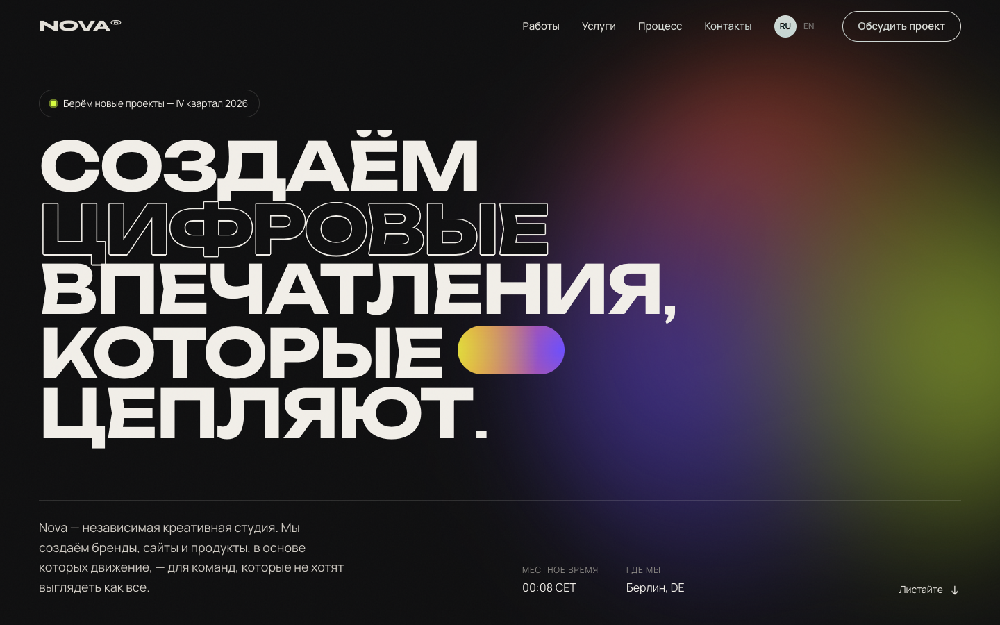
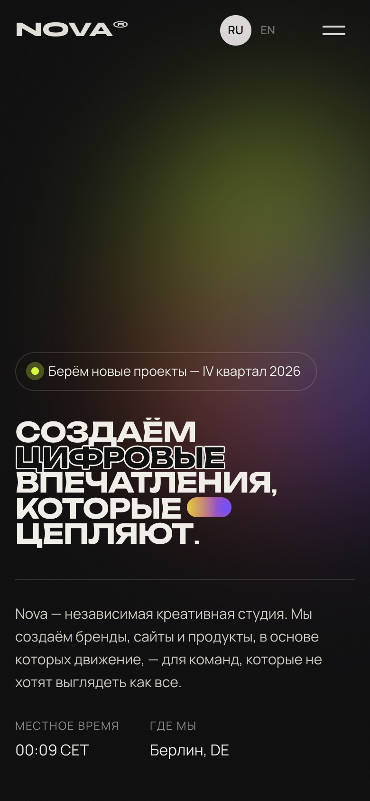

<div align="center">

# Nova Studio

**Сайт креативного digital-агентства** · RU / EN

<a href="https://cdduke.github.io/nova-studio/"></a>

    

&nbsp;

*🇬🇧 Animated website for a creative digital agency — custom cursor, magnetic buttons, horizontal case-study scroll, marquee.*

</div>

---

Концепт-сайт вымышленной digital-студии с акцентом на анимации и интерактив.
**Двуязычный: русский (по умолчанию) и английский** — переключатель RU / EN в шапке.

**Стек:** Vite · Vanilla JS · GSAP (ScrollTrigger) · Lenis (плавный скролл) · CSS без фреймворков

## Что внутри

- Прелоадер со счётчиком и шторкой-переходом
- Анимированный hero: построчное появление заголовка, живой градиент, часы Берлина
- Кастомный курсор (меняется над ссылками и карточками) и «магнитные» кнопки
- Бегущая строка, которая ускоряется и меняет направление вместе со скроллом
- Текст, который «проявляется» по словам при прокрутке, счётчики статистики
- Закреплённая горизонтальная галерея проектов с параллаксом (на телефоне — свайп)
- Список услуг с превью, следующим за курсором
- Карточки этапов работы, складывающиеся в стопку (sticky)
- Слайдер отзывов с автопрокруткой и свайпом
- Полноэкранное мобильное меню, скрытие шапки при скролле вниз
- Локализация RU/EN без перезагрузки: тексты, мета-теги, подписи курсора; для кириллицы подключён Unbounded (у Syne нет кириллицы), размеры типографики подстроены под длину русских слов

## Адаптивность и доступность

- Проверено на 375px (телефон), 768px (планшет), 1440px (десктоп)
- На сенсорных экранах курсор и hover-эффекты отключаются, галерея превращается в свайп-карусель
- Уважает `prefers-reduced-motion`: анимации отключаются
- Семантическая разметка, `aria`-атрибуты, фокус-стили для клавиатуры

## Запуск

```bash
npm install
npm run dev      # http://localhost:5173
npm run build    # сборка в dist/
```

---

*Concept website built as a portfolio piece. All brands and people are fictional. Bilingual: Russian / English.*


**Демо:** https://cdduke.github.io/nova-studio/
